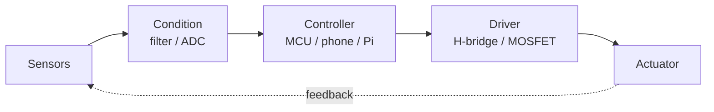

<div align="center">


</div>

```text
[  OK  ] mounted /dev/coffee
[  OK  ] loaded module: embedded_c
[  OK  ] loaded module: android_internals
[  OK  ] loaded module: linux_tooling
[ WARN ] sleep.service: not found
[  OK  ] reached target: building_things
```

## // DATASHEET

| Parameter        | Value                                                        |
| ---------------- | ------------------------------------------------------------ |
| Part number      | `Andreaz254`                                                 |
| Discipline       | Mechatronics: mechanics, electronics, control, code          |
| Location         | Nyeri, Kenya (UTC+03:00)                                     |
| Operating mode   | Reads the source, then the datasheet, then the source again  |
| Currently on     | `nanika`: Android tunnel client (SSH / VLESS / VMess)        |
| Learning         | <!-- EDIT: e.g. RTOS, PID tuning, KiCad, Rust -->            |
| Ask me about     | <!-- EDIT: e.g. VPN internals, sensors, motor drivers -->    |
| Reach me         | <!-- EDIT: email or link -->                                 |

## // SIGNAL CHAIN



## // TOOLBOX

<p>
  
</p>

<!-- Tools without an icon: edit freely -->


## // TELEMETRY (live, refreshed by GitHub on every page load)

<p align="center">
  
</p>

<p align="center">
  
</p>

<p align="center">
  
  
</p>

<p align="center">
  
</p>

## // ON THE BENCH

<a href="https://github.com/Andreaz254/nanika">
  
</a>

<!-- Add more pins by copying the block above and changing repo=... -->

<div align="center">

<sub>`/* no workflow, no cron, no bots. Just URLs that GitHub fetches live. */`</sub>


</div>
